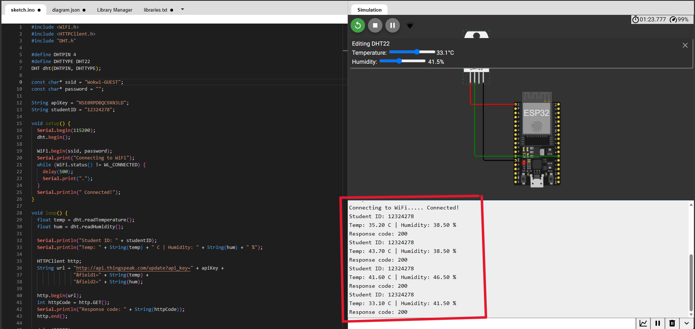
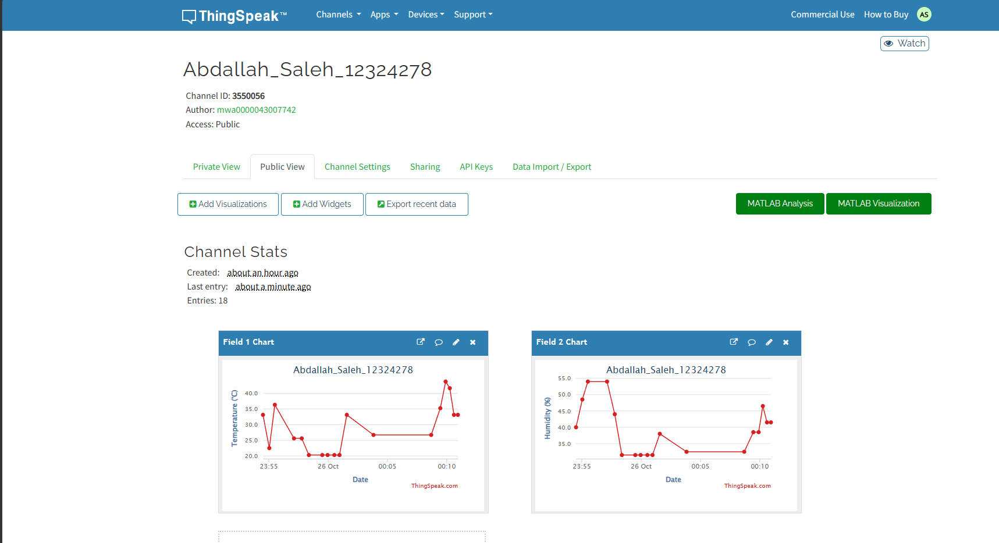

# Homework: ESP32 to ThingSpeak

The project connects ESP32 to a DHT22 sensor to read temperature and humidity. I used ThingSpeak to add the graphs of the 2 sensors, in wokwi The ESP32 connects to Wi-Fi and sends the sensor readings to ThingSpeak every 20 seconds using an HTTP GET request. The data is updated live and can be seen on the public graph in ThingSpeak

## ThingSpeak Public URL
- https://thingspeak.com/channels/3550056

## Wokwi Link
- https://wokwi.com/projects/478893576752496641
## Student Information
- Name: Abdallah Saleh
- University ID: 12324278

## Wiring Diagram / Schematic
- VCC -> 3.3V
- GND -> GND
- DATA -> GPIO 4

## Here are the Screenshots:

